# Un ordinateur quantique dans la main, avec un ESP32

**5 qubits, 32 amplitudes complexes, un écran tactile :** la carte ES3C28P (ESP32-S3, écran 2,8") devient un ordinateur quantique de poche. On y pose des portes au doigt (H, X, CNOT, Toffoli, rotations, mesure…), et on voit le calcul se dérouler pas à pas. Les amplitudes interfèrent, les qubits s'intriquent, la sphère de Bloch tourne, et la mesure fait « s'effondrer » l'état avec un vrai hasard physique tiré du bruit de la radio de la puce.

Trois tutoriels animés sont aussi sur la carte :
- **les différents types d'équations** du calcul quantique (linéaire, paramétrique, matricielle, différentielle, aux valeurs propres…) ;
- **les algorithmes quantiques connus** (Shor, Grover, QFT, chimie, optimisation, cryptographie…), avec leur utilité concrète et leur maturité aujourd'hui ;
- **un pont vers un vrai ordinateur quantique** : la carte écrit le circuit en OpenQASM et l'affiche en QR code. On l'exécute ensuite sur un processeur quantique d'IBM, gratuitement.

C'est la saison 3 d'une série de projets de physique avec des ESP32, après [**la vitesse de la lumière**](https://github.com/Edunts5962/Esp32-vitesse-de-la-lumi-re-) et [**la vitesse du son**](https://github.com/Edunts5962/Esp32-vitesse-du-son). Le projet reprend le même [moteur graphique](https://github.com/Edunts5962/Esp32-gfx-moteur-graphique), le même style d'interface et le même simulateur PC.

| Construire un circuit et le lire pas à pas | La sphère de Bloch : chaque porte est une rotation |
|---|---|
| 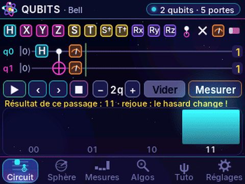 | 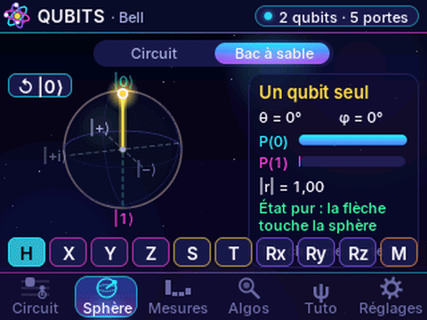 |
| **1 000 tirs : Grover trouve 101 à 94,5 %** | **Les algorithmes et leur utilité** |
| 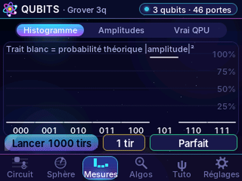 | 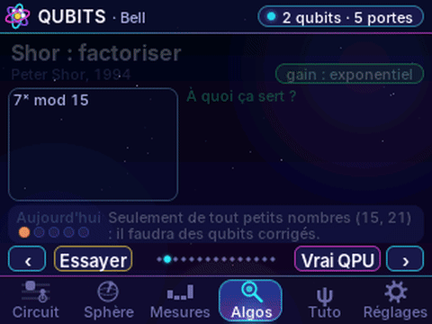 |

> 🚀 Installer sans rien compiler : [`TUTO_INSTALLATION.md`](TUTO_INSTALLATION.md) (firmware prêt à flasher depuis le navigateur dans [`binaires/`](binaires/))
> 🎬 Vidéo de présentation : page **Releases**, avec ses sous-titres .srt. Titre, description et chapitres YouTube : [`video_youtube.md`](video_youtube.md)
> 🎓 Protocole pour étudiants : [`protocole_etudiants.md`](protocole_etudiants.md) · 📤 Publication : [`DEPLOIEMENT_GITHUB.md`](DEPLOIEMENT_GITHUB.md)

---

## Sommaire

1. [Le principe](#1-le-principe)
2. [Le matériel](#2-le-matériel)
3. [Les fichiers du projet](#3-les-fichiers-du-projet)
4. [Installation](#4-installation)
5. [Les écrans et tous les réglages](#5-les-écrans-et-tous-les-réglages)
6. [Sur un vrai ordinateur quantique](#6-sur-un-vrai-ordinateur-quantique)
7. [Ce que calcule la carte](#7-ce-que-calcule-la-carte)
8. [Mode opératoire rapide](#8-mode-opératoire-rapide)
9. [Simulateur PC et vérifications](#9-simulateur-pc-et-vérifications)
10. [Dépannage](#10-dépannage)
11. [Licence et crédits](#11-licence-et-crédits)

---

## 1. Le principe

### Un qubit, c'est un vecteur

Un bit vaut 0 **ou** 1. Un qubit est un **vecteur** qui mélange les deux :

> **|ψ⟩ = α|0⟩ + β|1⟩**   avec   **|α|² + |β|² = 1**

α et β sont des nombres complexes, les **amplitudes**. Quand on mesure, on obtient 0 avec la probabilité |α|², et 1 avec la probabilité |β|² : c'est la **règle de Born**. Ensuite, l'état « s'effondre » sur le résultat obtenu.

### Les portes sont des rotations

Une porte quantique multiplie le vecteur par une matrice **unitaire**. Pour un qubit, c'est toujours une **rotation de la sphère de Bloch** :

- **H** (Hadamard) envoie |0⟩ sur l'équateur : la superposition ;
- **X** est le NON quantique, un demi-tour qui échange |0⟩ et |1⟩ ;
- **Z, S, T** tournent la **phase**, autour de l'axe vertical ;
- **Rx, Ry, Rz** tournent d'un angle θ au choix.

### Plusieurs qubits : le produit tensoriel et l'intrication

Avec n qubits, il y a **2ⁿ amplitudes** : 32 pour 5 qubits, et plus de 10¹⁵ pour 50. Certaines combinaisons ne se séparent pas en un état par qubit. Par exemple, l'**état de Bell** (|00⟩ + |11⟩)/√2 ne peut pas s'écrire comme un produit : c'est l'**intrication**. Les deux qubits donnent toujours le même résultat, mais aucun des deux n'a de valeur avant la mesure. Sur la sphère de Bloch de la carte, la flèche d'un qubit intriqué **rétrécit** jusqu'au centre : il n'a plus d'état à lui.

### L'interférence, le moteur des algorithmes

Les amplitudes s'ajoutent comme des vagues : ½ + ½ = 1, mais ½ − ½ = 0. Un algorithme quantique est une chorégraphie d'interférences qui renforce les bonnes réponses et éteint les mauvaises. Par exemple, Grover fait grandir l'amplitude de la réponse cherchée à chaque tour.

### Le hasard est vrai

Chaque mesure tire au sort avec `esp_random()`. Quand la radio Wi-Fi de l'ESP32 est allumée (sans se connecter à rien), ce générateur mélange le **bruit physique** du récepteur radio : c'est un vrai hasard. Le réglage « Graine fixe » rend les tirs reproductibles, pour comparer en classe.

---

## 2. Le matériel

- **Une carte ES3C28P**, la même que pour les saisons précédentes :
  - puce ESP32-S3 avec 8 Mo de PSRAM et 16 Mo de flash ;
  - écran ILI9341 de 2,8" avec tactile FT6336 ;
  - lecteur microSD ;
  - codec audio ES8311 avec haut-parleur (clics des mesures).
- Facultatif :
  - une carte microSD pour enregistrer les résultats et les fichiers `.qasm` ;
  - un téléphone pour scanner les QR codes ;
  - un compte gratuit IBM Quantum pour le vrai ordinateur quantique.

Il n'y a **rien à câbler**. Voici le brochage, déjà sur la carte :

| Fonction | GPIO |
|---|---|
| I2S MCLK / BCLK / WS / données vers le haut-parleur | 4 / 5 / 7 / 8 |
| Ampli du haut-parleur | 1 |
| I2C (tactile + codec à l'adresse 0x18) | SDA 16 / SCL 15 |
| Écran | SPI 10-13, DC 46, rétroéclairage 45 |
| microSD (SDIO 1 bit) | 38, 40, 39 |

**Répartition du travail dans la puce :**

- **cœur 1** : tactile, simulation quantique et dessin de l'image (double tampon en PSRAM) ;
- **cœur 0** : envoi de l'image à l'écran, et tâche « son » qui joue les clics de mesure.

Le simulateur quantique est assez rapide pour calculer le vecteur d'état **à chaque image** pendant les animations. Il lance aussi 8 192 tirs en moins de deux secondes.

---

## 3. Les fichiers du projet

```
firmware/quantique_console/
  quantique_console.ino   la carte : écran, tactile, son ES8311, hasard matériel, SD
  quantique.cpp/.h        LE SIMULATEUR : vecteur d'état, portes, mesures, bruit, OpenQASM, algorithmes
  interface.cpp/.h        barres, navigation, démarrage, réglages, lecture pas à pas, tirs
  ecran_circuit.cpp       éditeur de circuits, amplitudes en direct
  ecran_bloch.cpp         sphère de Bloch (circuit et bac à sable)
  ecran_mesures.cpp       histogramme, tir unique, roues des amplitudes
  ecran_qpu.cpp           vers un vrai ordinateur quantique : QR codes, fichier .qasm
  ecran_algos.cpp         les 15 fiches des algorithmes quantiques
  ecran_tuto.cpp          les 15 pages des types d'équations
  formule.cpp             petit moteur de formules (fractions, racines, matrices, exposants)
  ui_commun.h             palette et outils partagés
  gfx.cpp/.h              moteur de dessin lissé (Esp32-gfx-moteur-graphique)
  polices.cpp/.h          police Inter avec accents, lettres grecques, ⟨ ⟩ ⊗ ħ (générée)
  qrcodegen.c/.h          générateur de QR codes (Project Nayuki, MIT)
  ft6336_touch.*          pilote du tactile (inchangé)
  plateforme.h            ce que le cœur du programme demande au matériel
binaires/
  quantique_console_complet.bin   firmware complet, à flasher à l'adresse 0x0
outils/
  simulateur/sim_main.cpp   le même code sur PC : scénario tactile, captures, séquences
  simulateur/build.sh       compilation du simulateur
  faire_gifs.sh             GIF du README
  tests/exporter_qasm.cpp   exporte l'OpenQASM et les probabilités de la carte…
  tests/verifier_qasm.py    … et les compare avec Qiskit (IBM)
  video/                    voix off et montage de la vidéo
  generer_polices.py        générateur des polices
images/ecrans/              captures de tous les écrans
animations/                 GIF animés
protocole_etudiants.md      TP pour la classe
TUTO_INSTALLATION.md        installation sans compiler
video_youtube.md            titre, description et chapitres YouTube
```

Tout le code, sauf le `.ino`, est **identique sur la carte et sur le PC**.

---

## 4. Installation

> **Le plus simple, sans compiler** : suivre [`TUTO_INSTALLATION.md`](TUTO_INSTALLATION.md). Ce qui suit sert à compiler soi-même.

Il faut Arduino IDE 2.x avec le paquet **esp32 3.x** (vérifié en compilation avec 3.3.2), et la bibliothèque **TFT_eSPI**, configurée pour l'écran comme pour la console NES et les projets précédents. Aucune autre bibliothèque n'est nécessaire : le générateur de QR codes est dans le croquis.

Ouvrir `firmware/quantique_console/quantique_console.ino`, puis régler :

| Réglage | Valeur |
|---|---|
| Carte | ESP32S3 Dev Module |
| PSRAM | OPI PSRAM |
| Flash Size | 16 MB |
| Partition Scheme | 16M Flash (3MB APP/9.9MB FATFS) |
| USB CDC On Boot | Enabled (pour le moniteur série) |

Le programme pèse environ 1,2 Mo (le Wi-Fi est inclus pour le hasard matériel). L'**étalonnage du tactile** est partagé avec les projets précédents : il n'est demandé qu'une fois.

---

## 5. Les écrans et tous les réglages

La barre du haut affiche le nom du circuit et une pastille d'état : nombre de qubits et de portes, « Pas 3 / 9 » pendant la lecture, « Effondrement ! » pendant une mesure, « Tirs 512 / 1000 ». Il y a six onglets en bas.

### 5.1 Démarrage

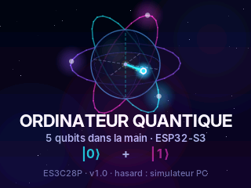

Un atome et une sphère de Bloch tournent pendant que |0⟩ et |1⟩ clignotent ensemble. On peut toucher l'écran pour passer.

### 5.2 Onglet **Circuit**

| L'état de Bell | Lecture : la porte H | Lecture : CNOT | Mesure : effondrement |
|---|---|---|---|
| 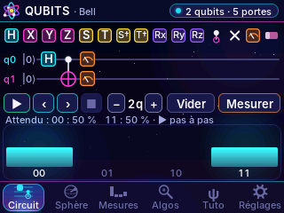 | 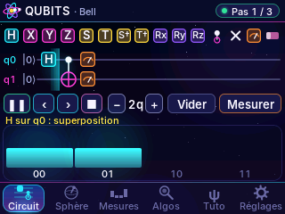 | 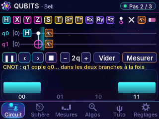 | 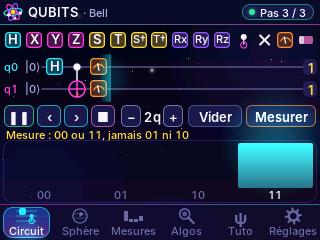 |

- **La palette** (en haut) : H, X, Y, Z, S, T, S†, T†, Rx, Ry, Rz, ● (contrôle), × (échange), M (mesure) et la gomme. Toucher un outil affiche son rôle.
- **Le circuit** : de 1 à 5 fils (q0 en haut), jusqu'à 24 colonnes, avec défilement par glissement.
  - Un ● contrôle **toutes** les portes de sa colonne : ● + X = CNOT, ● ● + X = Toffoli, ● + Z = CZ.
  - Deux × dans une colonne font un SWAP.
  - Sans outil choisi, toucher une porte ouvre l'**inspecteur** : son rôle, l'angle θ des rotations (curseur au pas de 7,5°, raccourcis π/4, π/2, π, −π/2) et « Supprimer ».
- **Les commandes** :
  - ▶ / ❚❚ lance ou met en pause la **lecture pas à pas** : un faisceau balaie le circuit, chaque porte s'applique en douceur (la carte calcule une *fraction* de porte, voir § 7), et chaque mesure fait s'effondrer l'état avec un éclair et un clic ;
  - ‹ et › avancent ou reculent d'une colonne, ■ revient à l'état final ;
  - − et + changent le nombre de qubits ;
  - « Vider » efface le circuit (il faut confirmer) ;
  - « Mesurer » passe à l'onglet Mesures et lance les tirs.
- **La légende** : pour un algorithme de la bibliothèque, elle explique chaque colonne pendant la lecture, puis affiche le résultat attendu.
- **Les amplitudes**, en bas : une barre par état de base. La **hauteur** est la probabilité |a|², la **couleur** est la phase (cyan = 0, rouge = π). Toucher une barre affiche l'état, sa probabilité et sa phase.

| Construire GHZ à la main | L'inspecteur d'une rotation | Grover à 3 qubits |
|---|---|---|
| 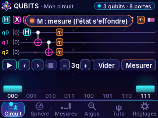 | 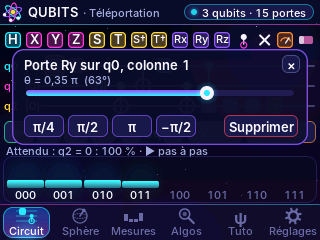 | 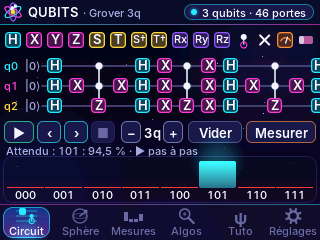 |

### 5.3 Onglet **Sphère**

| Téléportation : q2 reçoit l'état | Bell : q0 n'a plus d'état à lui | Bac à sable |
|---|---|---|
| 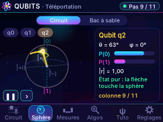 | 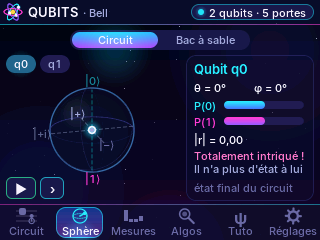 | 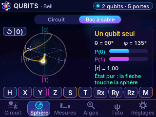 |

- **Circuit** : la sphère de Bloch d'un qubit (q0 à q4), à la position de la lecture. Une traînée jaune suit la pointe de la flèche. À droite s'affichent θ, φ, P(0), P(1) et **|r|**, la longueur de la flèche : 1 pour un état pur, moins de 1 si le qubit est intriqué (ou mesuré dans un mélange).
- **Bac à sable** : un qubit seul et dix boutons (H, X, Y, Z, S, T, Rx, Ry, Rz de π/4, et M). Chaque porte fait **tourner** la flèche sous nos yeux, autour de son axe qui s'allume en rose. M mesure : la flèche saute au pôle tiré au sort. « ↺ |0⟩ » remet le qubit à zéro.
- Glisser sur la sphère la fait tourner. Laissée tranquille, elle tourne doucement.

### 5.4 Onglet **Mesures**

| 1 000 tirs de Grover | Avec le bruit d'un vrai QPU | Un seul tir | Les roues des amplitudes |
|---|---|---|---|
| 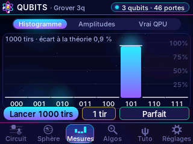 | 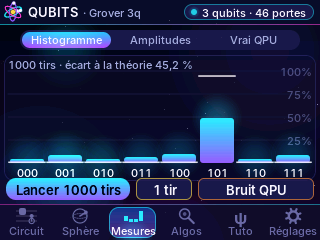 | 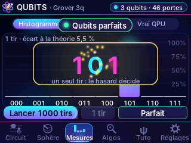 | 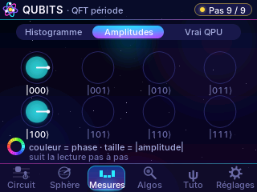 |

- **Histogramme** :
  - « Lancer N tirs » répète le circuit 100, 1 000 ou 8 192 fois. L'histogramme se remplit en direct, au rythme des clics.
  - Le **trait blanc** donne la probabilité théorique, et la carte affiche l'**écart à la théorie** (la distance entre les deux distributions).
  - Seuls les qubits qui portent une mesure M sont comptés, comme sur un vrai QPU. S'il n'y a aucune mesure, tous les qubits sont mesurés.
  - « 1 tir » fait défiler les chiffres comme une machine à sous, puis le hasard décide.
  - Le bouton de droite choisit le **bruit** : Parfait, Bruit faible (0,4 % d'erreur par porte), ou **Bruit QPU** (environ 2 % par porte et 2,5 % à la lecture, l'ordre de grandeur d'un vrai processeur). Grover à 3 qubits passe alors de 94,5 % à 50 % environ.
- **Amplitudes** : chaque état de base est une roue. La taille est |a|, l'aiguille et la couleur sont la phase. La vue suit la lecture pas à pas.
- **Vrai QPU** : voir § 6.

### 5.5 Onglet **Algos**

| | | |
|---|---|---|
| 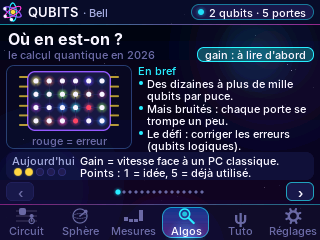 | 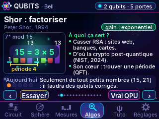 | 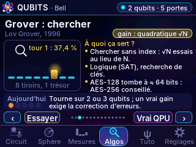 |
| 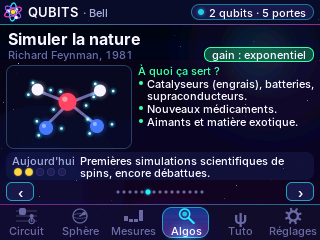 | 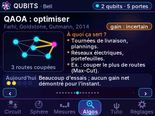 | 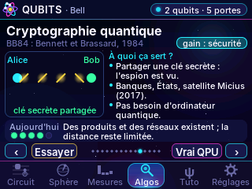 |

Quinze fiches animées. Chacune donne l'origine, le **gain** espéré face à un ordinateur classique, **à quoi ça sert** dans la vie, et **où on en est aujourd'hui** (de 1 point, une idée, à 5, déjà utilisé). On change de fiche avec ‹ et › ou en glissant.

| Fiche | Gain | Ça sert à… | Démo |
|---|---|---|---|
| Où en est-on ? | — | qubits bruités, correction d'erreurs | — |
| Shor | exponentiel | casser RSA, d'où la cryptographie post-quantique | QFT période |
| Grover | quadratique √N | chercher, logique, clés symétriques | Grover 3 qubits |
| Fourier quantique | exponentiel | brique de Shor et de l'estimation de phase | QFT période |
| Estimation de phase | exponentiel | énergies des molécules | Phase de T |
| Simuler la nature | exponentiel | catalyseurs, batteries, médicaments | — |
| VQE | incertain | chimie sur machines bruitées | — |
| QAOA | incertain | tournées, plannings, réseaux électriques | — |
| HHL | exponentiel* | systèmes linéaires (sous conditions) | — |
| Apprentissage quantique | incertain | classer des données (prudence) | — |
| Cryptographie (BB84) | sécurité | clés secrètes inviolables | Bell |
| Téléportation | nouveau | internet quantique | Téléportation |
| Hasard quantique | vrai hasard | clés, tirages | Hasard 5 qubits |
| Correction d'erreurs | indispensable | qubits logiques | — |
| Deutsch-Jozsa, Bernstein-Vazirani | exponentiel (jouet) | apprendre | Bernstein-Vazirani |

« Essayer » charge la démonstration dans le circuit et lance la lecture. « Vrai QPU » prépare son export vers un vrai ordinateur quantique.

### 5.6 Onglet **Tuto** : les types d'équations

| | | |
|---|---|---|
| 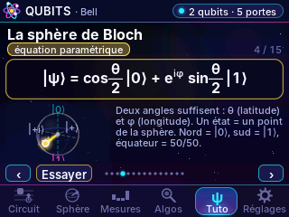 | 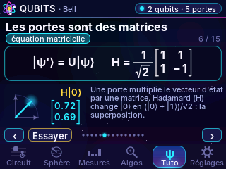 | 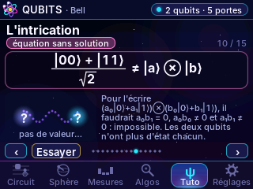 |
| 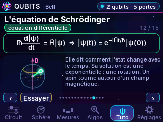 | 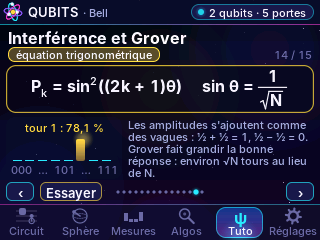 | 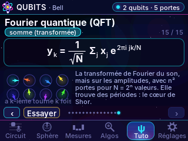 |

Quinze pages. Chacune présente un **type d'équation** (badge coloré), la formule mise en page sur l'écran (fractions, racines, matrices, exposants), une animation et une explication :

1. Sommaire
2. La superposition : **équation linéaire**, |ψ⟩ = α|0⟩ + β|1⟩
3. Normalisation et règle de Born : **équation quadratique**, |α|² + |β|² = 1
4. La sphère de Bloch : **équation paramétrique**, cos(θ/2)|0⟩ + e^(iφ) sin(θ/2)|1⟩
5. La phase : **identité d'Euler**, e^(iφ) = cos φ + i sin φ
6. Les portes : **équation matricielle**, |ψ'⟩ = U|ψ⟩, la matrice de Hadamard
7. L'unitarité : **équation de contrainte**, U†U = I
8. Les rotations : **exponentielle de matrice**, Rx(θ) = e^(−iθX/2)
9. Plusieurs qubits : **produit tensoriel**, 2ⁿ amplitudes
10. L'intrication : **équation sans solution**, (|00⟩ + |11⟩)/√2 ≠ |a⟩ ⊗ |b⟩
11. La mesure : **équation probabiliste**, P(x) = |⟨x|ψ⟩|²
12. Schrödinger : **équation différentielle**, iħ d|ψ⟩/dt = Ĥ|ψ⟩
13. L'énergie : **équation aux valeurs propres**, Ĥ|E⟩ = E|E⟩
14. Grover : **équation trigonométrique**, P = sin²((2k+1)θ)
15. La QFT : **transformée (somme)**, le lien avec la saison Fourier

« Essayer » ouvre la démonstration correspondante : un circuit, ou le bac à sable de la sphère.

### 5.7 Onglet **Réglages**

| Calcul | Appareil |
|---|---|
| 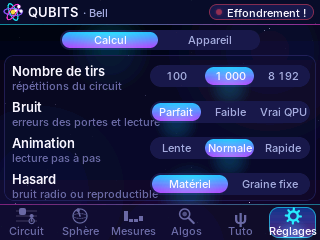 | 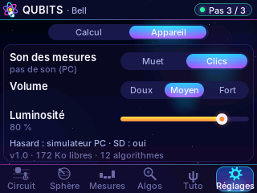 |

| Page | Réglage | Choix |
|---|---|---|
| Calcul | Nombre de tirs | 100 / 1 000 / 8 192 |
| Calcul | Bruit | Parfait / Faible / Vrai QPU |
| Calcul | Animation | Lente / Normale / Rapide |
| Calcul | Hasard | Matériel (bruit radio) / Graine fixe (reproductible) |
| Appareil | Son des mesures | Muet / Clics |
| Appareil | Volume | Doux / Moyen / Fort |
| Appareil | Luminosité | 5 à 100 % |

La page Appareil indique aussi la source du hasard, la carte SD et la mémoire libre. Les réglages et le circuit en cours sont gardés en mémoire.

---

## 6. Sur un vrai ordinateur quantique

| Les étapes et le QR du lien | Le QR du circuit | En plein écran, pour le scanner |
|---|---|---|
| 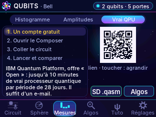 | 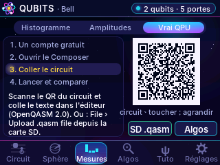 | 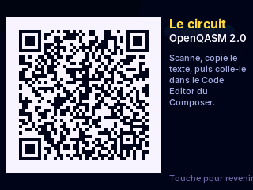 |

La carte simule exactement des qubits parfaits. Pour voir de **vrais** qubits, avec leurs défauts, l'onglet **Mesures › Vrai QPU** prépare le circuit pour **IBM Quantum Composer**, l'éditeur en ligne d'IBM :

1. **Un compte gratuit** sur IBM Quantum Platform. L'offre « Open » donne jusqu'à 10 minutes de processeur quantique réel par période glissante de 28 jours, ce qui représente des dizaines de petits circuits.
2. **Ouvrir le Composer** : scanner le premier QR code (lien `quantum.cloud.ibm.com/composer`), puis ouvrir l'éditeur de code avec *View › Panels › Code Editor*.
3. **Coller le circuit** : scanner le second QR code, qui contient le texte du circuit en **OpenQASM 2.0**, le langage qu'accepte le Composer. Il suffit de le coller dans l'éditeur. Autre possibilité : le bouton « SD .qasm » écrit le fichier dans `/quantique/` sur la carte SD, à importer avec *File › Upload .qasm file*.
4. **Lancer et comparer** : *Run circuit*, choisir un processeur, 1 000 tirs. Le résultat arrive dans la page *Workloads*. On le compare avec l'histogramme de la carte réglé sur « Bruit QPU ».

Les algorithmes de la bibliothèque sont tous exportables. Les fiches « Algos » ont un bouton « Vrai QPU » qui fait tout en une fois.

Toutes les portes de la console ont leur équivalent dans `qelib1.inc`, la bibliothèque standard d'OpenQASM 2 : h, x, y, z, s, sdg, t, tdg, rx, ry, rz, cx, cy, cz, ch, cu1, cu3, crz, ccx, swap, cswap. Seules les colonnes à trois contrôles ou plus ne sont pas exportables, et la carte le signale. La conversion a été **vérifiée avec Qiskit**, la bibliothèque d'IBM (§ 9) : mêmes probabilités, même ordre des bits (q0 à droite, comme sur les histogrammes d'IBM).

> Les résultats d'un vrai QPU sont **bruités** : pour l'état de Bell, on lit quelques pour cent de 01 et de 10, qui sont impossibles en théorie. C'est l'occasion de parler de décohérence et de correction d'erreurs.

---

## 7. Ce que calcule la carte

### Le vecteur d'état

L'état de n qubits est un tableau de 2ⁿ nombres complexes (32 pour 5 qubits). Le bit k de l'indice i est la valeur du qubit k : a[5] est l'amplitude de |101⟩, avec q0 = 1, q1 = 0 et q2 = 1.

Une porte à un qubit sur le qubit t, contrôlée par un ensemble C de qubits, agit sur chaque paire d'indices (i, i + 2ᵗ) dont les bits de C valent 1 :

> (a₀, a₁) → (m₀₀ a₀ + m₀₁ a₁ , m₁₀ a₀ + m₁₁ a₁)

### Les portes comme rotations, et l'animation

Toute porte à un qubit s'écrit **V = e^(iα) · (cos(θ/2) I − i sin(θ/2) n·σ)** : une phase globale α, et une rotation d'angle θ autour d'un axe n.

| Porte | α | θ | axe n |
|---|---|---|---|
| H | π/2 | π | (x + z)/√2 |
| X, Y, Z | π/2 | π | x, y, z |
| S, T | π/4, π/8 | π/2, π/4 | z |
| Rx, Ry, Rz | 0 | θ | x, y, z |

Pour animer une porte, la carte applique **Vᵘ**, avec u qui va de 0 à 1 : la même rotation, d'angle θ·u, avec la phase α·u. Le résultat est exact à chaque image : la flèche de Bloch parcourt un vrai chemin de rotation et les amplitudes passent d'une valeur à l'autre sans quitter la sphère des états. Le SWAP s'anime de la même façon : sa partie antisymétrique tourne de e^(iπu).

### Les mesures et les tirs

- **Mesurer** le qubit k : on calcule P(1), on tire au sort, on met à zéro les amplitudes incompatibles, puis on renormalise.
- **Tirs rapides** : sans bruit et sans mesure au milieu du circuit, la carte calcule une fois les probabilités finales et tire N résultats dedans.
- **Sinon**, chaque tir rejoue tout le circuit :
  - **bruit des portes** : après chaque porte, avec la probabilité p, une erreur de Pauli X, Y ou Z au hasard (canal dépolarisant) ;
  - **bruit de lecture** : chaque bit lu est inversé avec la probabilité p_l ;
  - **mesures intermédiaires** : elles font vraiment s'effondrer l'état en cours de route.
- Chaque série de tirs terminée ajoute une ligne à `quantique.csv` sur la carte SD : circuit, nombre de tirs, bruit, source du hasard, puis chaque résultat avec son compte.

### La sphère de Bloch d'un qubit parmi plusieurs

Pour le qubit k, la carte calcule la **matrice densité réduite** : ρ₀₀, ρ₁₁ et ρ₀₁ = Σ aᵢ·conj(aᵢ₊₂ᵏ). Elle en déduit le vecteur de Bloch :

> x = 2 Re ρ₀₁,   y = −2 Im ρ₀₁,   z = ρ₀₀ − ρ₁₁

Sa longueur vaut 1 pour un qubit pur, et 0 pour un qubit totalement intriqué.

### Les algorithmes de la bibliothèque

| Algorithme | Qubits | Colonnes | Résultat calculé par la carte |
|---|---|---|---|
| Pile ou face | 1 | 2 | 0 : 50 %, 1 : 50 % |
| Interférence (Mach-Zehnder) | 1 | 4 | 1 : 100 % |
| État de Bell | 2 | 3 | 00 : 50 %, 11 : 50 % |
| GHZ | 3 | 4 | 000 : 50 %, 111 : 50 % |
| Deutsch-Jozsa (f = x0 ⊕ x1) | 3 | 6 | 11 : 100 % (fonction équilibrée) |
| Bernstein-Vazirani (secret 101) | 4 | 6 | 101 : 100 % |
| Grover 2 qubits | 2 | 8 | 11 : 100 % |
| Grover 3 qubits (2 tours) | 3 | 18 | 101 : 94,5 % |
| Téléportation (mesures différées) | 3 | 11 | q2 = 0 : 100 % |
| QFT : trouver une période | 3 | 9 | 000 et 100 : 50 % → période 2 |
| Estimation de phase de T | 4 | 13 | 001 : 100 % → phase 1/8 |
| Hasard | 5 | 2 | 32 résultats à 3,1 % |

---

## 8. Mode opératoire rapide

1. Onglet **Circuit** : l'état de Bell est déjà chargé. Toucher ▶ et regarder la superposition, puis l'intrication, puis l'effondrement. Rejouer : le résultat change, mais c'est toujours 00 ou 11.
2. Onglet **Sphère**, q0 : la flèche est au centre, car le qubit est intriqué. Passer au **Bac à sable** et jouer avec H, S, T et la mesure.
3. Onglet **Mesures** : « Lancer 1000 tirs ». Puis le bouton « Bruit QPU », et relancer : des 01 et des 10 apparaissent.
4. Onglet **Algos** : la fiche **Grover**, puis « Essayer ». Ensuite, dans Mesures, 1 000 tirs : 101 sort environ 945 fois.
5. Onglet **Tuto** : parcourir les types d'équations, et « Essayer » sur la page de l'intrication.
6. **Vrai QPU** : exporter Bell, le lancer chez IBM, comparer.

Le protocole complet, avec questions et valeurs attendues, est dans [`protocole_etudiants.md`](protocole_etudiants.md).

---

## 9. Simulateur PC et vérifications

```
cd outils/simulateur
./build.sh                 # g++ : le même code que la carte
./sim cap                  # scénario tactile complet : captures (.ppm) et séquences d'images
cd .. && ./faire_gifs.sh simulateur/cap ../animations
```

**Vérification avec Qiskit.** `outils/tests/exporter_qasm` écrit l'OpenQASM et les probabilités calculées par la carte pour les 12 algorithmes et 30 circuits tirés au hasard, qui utilisent toutes les portes, contrôlées ou non. `verifier_qasm.py` relit chaque fichier avec Qiskit, la bibliothèque d'IBM, calcule le vecteur d'état et compare :

```
cd outils/tests
g++ -std=c++17 -I../../firmware/quantique_console exporter_qasm.cpp ../../firmware/quantique_console/quantique.cpp -o exporter_qasm
mkdir qa && ./exporter_qasm qa
pip install qiskit && python3 verifier_qasm.py qa
```

Résultat : les 42 circuits concordent, avec un écart maximal de 2·10⁻⁵ (la précision des nombres `float` de la carte).

---

## 10. Dépannage

| Symptôme | Cause probable et remède |
|---|---|
| « Hasard : pseudo-aléatoire » | La radio n'a pas démarré. Redémarrer. Les tirs restent corrects, mais ne viennent plus d'un bruit physique. |
| Pas de clic à la mesure | Réglages › Appareil › Son « Clics », volume Fort. Le moniteur série indique l'état du codec au démarrage. |
| « Pose une 2ᵉ croix » | Un SWAP demande deux × dans la même colonne. |
| Une porte contrôlée ne fait rien | Le ● doit être dans la **même colonne** que la porte, et le qubit de contrôle doit valoir 1 (sinon rien ne se passe, c'est normal). |
| Le QR code ne se lit pas | Le toucher pour l'afficher en plein écran, monter la luminosité, éviter les reflets. Ou utiliser le fichier `.qasm` de la carte SD. |
| « Circuit trop long pour un QR code » | Utiliser « SD .qasm », puis *File › Upload .qasm file* dans le Composer. |
| « porte à 3 contrôles » | OpenQASM 2 ne connaît que 2 contrôles au plus (ccx). Décomposer la porte. |
| Les résultats du vrai QPU ≠ la carte | C'est normal : un vrai processeur est bruité. Comparer avec la carte réglée sur « Bruit QPU ». |
| Le tactile est décalé | Effacer l'étalonnage (il est partagé avec la console NES), puis redémarrer. |

---

## 11. Licence et crédits

- Code : licence MIT (voir [`LICENSE`](LICENSE)).
- Moteur graphique `gfx` (développé par Claude, d'Anthropic), repris de [Esp32-gfx-moteur-graphique](https://github.com/Edunts5962/Esp32-gfx-moteur-graphique). Ce projet, son simulateur quantique, ses écrans, ses tutoriels et sa documentation ont aussi été développés avec Claude.
- Générateur de QR codes **qrcodegen** © Project Nayuki, licence MIT.
- Police **Inter** © Rasmus Andersson, licence SIL Open Font License 1.1, et quelques symboles (⟨ ⟩ ℏ …) de **DejaVu Sans** (licence libre Bitstream Vera), intégrés sous forme d'images dans `polices.cpp`.
- Pilote tactile FT6336 et étalonnage repris de la console NES ES3C28P.
- IBM Quantum, Qiskit et IBM Quantum Composer sont des services et logiciels d'IBM. Ce projet n'est pas affilié à IBM.
